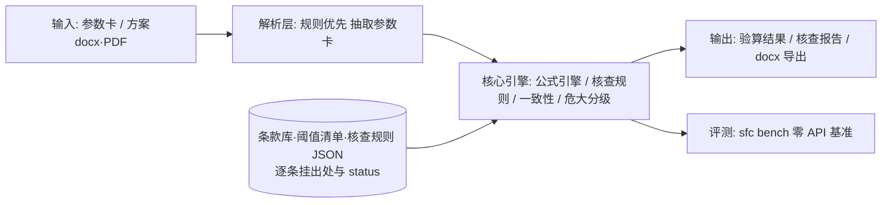

# DEVELOPMENT — 开发、里程碑与发布

本文件是**索引层**：只放里程碑状态、架构说明、基准指标与发布流程，正文一律链接到
`plan/` 与 `docs/`（避免双份维护）。用户向的定位、安装与判定依据见 [README.md](README.md)。

## 里程碑

| 里程碑 | 内容 | 状态 |
|---|---|---|
| M1 | 数据先行：条款库（原文核对纪律）+ 危大阈值清单 + 算例真值库 + 合成方案生成器 | ✅ 2026-10-07 |
| M2 | 公式引擎：5+1 验算模块，算例回归通过率 100% | ✅ 2026-10-07 |
| M3 | 方案解析 + 构造限值核查 + 两张皮一致性检测 + 危大分级判定器 | ✅ 2026-10-07 |
| M4 | 内置基准 `sfc bench`（零 API 依赖）+ docx 报告导出 `sfc report` | ✅ 2026-10-07 |
| M5 | PySide6 五页签 GUI + PyInstaller 双 exe（数据内嵌 + 构建红线断言）+ 技术报告 | ✅ 2026-10-07 |
| M6 | 脱敏发布 GitHub + v1.0.0 Release | ✅ 2026-10-07 |
| v2.0.0 | Python floor 3.8→3.10、依赖线重评、条款库复核机制、发布物重建 | ✅ 2026-10-19 |
| v2.0.1 | 修正 v2.0.0 发布物内嵌条款库未同步（7 文件回到 v1.0.0 旧副本）+ PEP 639 许可证迁移 | ✅ 2026-10-24 |

逐项细节：里程碑产出/DoD/偏差见 [plan/05-数据计划与里程碑.md](plan/05-数据计划与里程碑.md)；
发布门逐项留档见 [plan/RELEASE-M6.md](plan/RELEASE-M6.md)；全部决策见
[plan/06-决策记录.md](plan/06-决策记录.md)（#35 = v2.0.0 floor 拍板）。

## 架构



设计原则：数值结论永远来自确定性规则（零 LLM 通路）；未经原文核对（`status=待核对`）的条文
数值不进入计算路径；CLI/GUI 消费同一引擎 API。详见
[plan/03-架构与技术选型.md](plan/03-架构与技术选型.md) 与 [plan/04-模块详设.md](plan/04-模块详设.md)。

## 评测基准（`sfc bench` 一条命令复跑）

| 套件 | 指标 | 门限 | 现状 |
|---|---|---|---|
| examples | 算例真值回归通过率 | 100% | 100%（13/13：M-1~M-6 全主路径 + 2 条不合格路径） |
| synthetic | 合成方案核查 F1 / 误报数 | ≥0.95 / ≤0 | 1.000 / 0（12 冻结 fixtures：5 类注入×2 + 干净对照×2） |
| grading | 分级边界值用例通过率 | 100% | 100%（35/35；24/50m、20m、150m、7kN、模板支撑 5+4 条件全边界） |

零 API、离线、确定性可复现。参数扫描与条文纪律守门见 `tests/test_engine_card_sweep.py`、
`tests/test_engine_gate.py`；基准套件守门见 `tests/test_bench_suites.py`。

## 数据与条文纪律

- `data/knowledge/clauses/*.json`：条款/阈值/公式/危大清单，逐条挂出处 + `status`；
  每个文件另有 `meta.review`（复核日 / 下次复核日 / 周期 / 权威出处 URL / 结论）。
- 复核机制守门：`tests/test_clause_review.py`（复核元数据非空、URL 必填、panorama 条目级
  status 与 basis 级一致、待核对公式必须声明 `not_used_by` 且与真实依赖面一致、`fetched` 非空）。
- 台账（来源/许可/sha256/变更记录）：[data/README.md](data/README.md)。

## 打包与发布

```bash
python -m pip install -e ".[dev,build,gui]"     # 注意：GUI 侧 PySide6 必须装，否则 sfc-gui.exe 起不来
python tools/build_exe.py                       # 构建 + 构建后断言（禁区扫描 + 内嵌数据 sha256 对账）
python tools/build_exe.py --check               # 仅对既有 dist 做断言，期望 BUILD_CHECKS_OK
```

- PyInstaller onedir 单 spec 双入口（`tools/sfc.spec`）：`sfc.exe`（控制台）+ `sfc-gui.exe`（窗口）；
  数据白名单取自 `src/scaffold_formwork_checker/packaging.py`，**spec 内不手写任何数据路径**。
- 版权红线：`data/knowledge/raw/`（规范原文全文）绝不入包。
- 发布前：`python tools/desensitize_audit.py`（脱敏审计，硬门全 0）；
  README 门面门禁 `check_readme_gate.py . --strict`。
- 构建纪律：改了重依赖大版本必须**重建 exe 并真跑一遍**（历史教训：M6 CI 首跑才发现 docx
  冻结 fixture 随平台漂移，决策 #33）。

## 开发环境注意（Windows）

- `python` 可能指向商店占位符，请用 `py` 启动器；中文控制台建议 `py -X utf8`。
- pip 被系统代理污染时：`NO_PROXY="*" no_proxy="*"` 前缀 + 国内镜像。
- 仓库文本文件统一 LF（`.gitattributes`），`tests/test_eol_gate.py` 对全树做 CR 门。