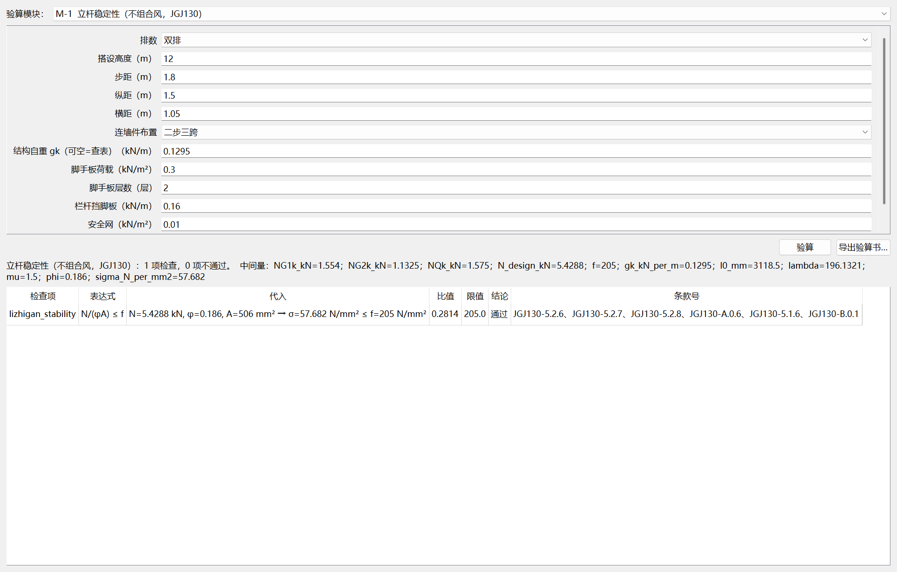

# scaffold-formwork-checker — 脚手架与模板支架安全验算及危大分级工具

面向施工安全领域的**规范驱动**桌面工具（Windows，全离线）：把"验算依据、核查结论、危大分级"
全部锚到规范条款号与政府文件原文上，结论可追溯、过程可复跑。

[](https://github.com/yuluo554/scaffold-formwork-checker/actions/workflows/ci.yml)



- **安全验算**：JGJ 130-2011 / JGJ 162-2008 规范公式验算（立杆稳定性、水平杆抗弯挠度、连墙件、
  地基承载力、模板支架立杆稳定），逐条挂条款号，中间量全展示；
- **专项方案文本核查**：解析专项施工方案（docx/PDF 文本）为参数卡，对照构造限值核查，
  并检测"方案 vs 验算书"两张皮一致性；
- **危大分级判定**：住建部令第 37 号 + 建办质〔2018〕31 号阈值清单化，三级判定
  （非危大 / 危大 / 超过一定规模须专家论证），结论挂文件+条款+原文摘录；
- **报告导出**：docx 验算书与核查报告（无时间戳、零外链、内置免责声明）；
- **桌面 GUI 与免安装 exe**：PySide6 五页签只消费引擎 API；PyInstaller 打包双 exe，
  数据内嵌、完全离线。

## 安装与运行

要求 **Python 3.10+**（Windows 建议用 `py` 启动器）。

```bash
py -m venv .venv
.venv/Scripts/python -m pip install -U pip
.venv/Scripts/python -m pip install -e ".[dev]"
.venv/Scripts/sfc selfcheck                        # 自检：版本/extras/数据目录
.venv/Scripts/python -m pytest tests -q            # 329 tests
```

免安装 exe（不想装 Python 时用）：到 [Release](https://github.com/yuluo554/scaffold-formwork-checker/releases/latest)
下载 `sfc-v2.0.1-windows-x64-onedir.zip`，解压后直接运行 `sfc\sfc.exe`（CLI）或
`sfc\sfc-gui.exe`（GUI）；数据内嵌，无需任何依赖。

> **v2.0.0 的 exe 附件请勿使用**：其内嵌的 7 个条款库 JSON 是 v1.0.0 的旧副本，
> v2.0.0 宣称新增的复核元数据（`meta.review`）在附件里并不存在（数值结论本身无误）。
> 详见 [CHANGELOG.md](CHANGELOG.md) 的 2.0.1 节。

## 常用命令

```bash
.venv/Scripts/sfc calc 参数卡.json                 # 验算（自动识别 M-1~M-6，逐条挂条款号）
.venv/Scripts/sfc check 专项施工方案.docx          # 构造限值核查 + 两张皮 + 分级联动
.venv/Scripts/sfc grade 专项施工方案.docx          # 仅危大分级（--param build_height=56）
.venv/Scripts/sfc report calc 参数卡.json -o 验算书.docx
.venv/Scripts/sfc bench                            # 三套件基准，一条命令复跑基准表
.venv/Scripts/sfc gui                              # 或 sfc-gui：五页签桌面 GUI
```

退出码口径（M0 起锁进测试，未改）：**0=完成 / 1=降级完成（含违规或依据未核对被拦截）/ 2=输入不可用或参数错误**。
`data/examples/` 各例内 `input_card` 字段存成 JSON 即为可喂给 `sfc calc` 的参数卡。

## 判定依据（版本 + 生效日 + 本次复核日）

本工具所有数值结论只来自下表依据；依据的现行性由 `tests/test_clause_review.py` 守门
（每个条款库文件必须登记复核日、下次复核日、权威出处 URL）。

| 判定依据 | 版本/文号 | 生效日期 | 本次复核日（2026-10-19）结论 |
|---|---|---|---|
| 建筑施工扣件式钢管脚手架安全技术规范 | JGJ 130-2011 | 2011-12-01 | 仍现行；16 条强制性条文自 2022-10-01 起由 GB 55023-2022 废止（本工具计算条文不在其中） |
| 建筑施工模板安全技术规范 | JGJ 162-2008 | 2008-12-01 | 仍现行（未检索到替代/废止公告） |
| 危险性较大的分部分项工程安全管理规定 | 住建部令第 37 号（2019 部令第 47 号修正） | 2018-06-01 | 现行 |
| 危大工程范围与超规模范围 | 建办质〔2018〕31 号 附件1/附件2 | 2018-05-17 | 现行（48 号编制指南、63 号严重缺陷清单为配套补充，非替代） |
| 施工脚手架通用规范（强制性） | GB 55023-2022 | 2022-10-01 | 现行；与上表不一致处以本规范为准（差异已在复核元数据中记录） |

依据原文全文（PDF/HTML）不入仓（版权红线），每份的核对渠道、sha256 与条款号摘录登记在
[data/README.md](data/README.md)；复核元数据（发布日/复核日/下次复核日/出处 URL）在各
`data/knowledge/clauses/*.json` 的 `meta.review`。

## 已知限制

- 文本路线解析只读文档文本（零识图、零 LLM）：扫描件/图片表格不可读，对应参数进
  "待人工确认"而非猜测；真实 PDF 版式兼容性属已知限制。
- 首期验算范围 6 个模块；碗扣式/盘扣式/附着式升降脚手架为规划扩展位，未实现。
- 危大分级按建办质〔2018〕31 号附件1/附件2 的脚手架与模板相关条目建模；基坑、起重吊装、
  拆除、幕墙等条目未建判定条目（扩展位留档）。
- **未完成项（明示）**：`F-J162-sidepressure`（模板侧压力）仍为 `待核对`——公式本体已按原文
  公式图目读一致，但参数表（t0/β1/β2/V/H 取值来源）未补全；本版本所有计算模块均不引用它
  （`not_used_by` 字段声明，并由测试校验声明与事实一致）。
- **规范差异（需单独决策，本版本不改数值）**：GB 55023-2022 表 4.2.4-2 规定混凝土结构模板
  支撑脚手架施工荷载标准值不应低于 2.5 kN/m²，而本工具 M-6 沿用的 JGJ 162-2008 4.1.2 计算
  支架立柱取值 1.0 kN/m²。二者口径不一致且 GB 55023-2022 为强制性规范；改动会牵动 13 例冻结
  算例、12 份合成 fixture 与基准真值，故列为独立决策项（见
  [plan/06-决策记录.md](plan/06-决策记录.md)），不在本次迭代内静默修改。

## 开发与文档

- 里程碑、架构图、评测基准明细、打包与发布流程：见 [DEVELOPMENT.md](DEVELOPMENT.md)
- 计划文档（题目/需求/架构/详设/数据里程碑/决策记录）：[plan/00-README总览.md](plan/00-README总览.md)
- 数据台账与条文纪律：[data/README.md](data/README.md)
- 技术报告：[docs/技术报告.md](docs/技术报告.md)；五页签截图：[docs/images/](docs/images/)

## 免责声明

本工具定位为**辅助验算与分级工具**，不替代专项施工方案编制、论证与审批。验算与判定结果
必须由具备相应资格的专业人员复核后方可使用；工具输出的一切结论均不构成工程决策依据。

## License

[MIT](LICENSE)